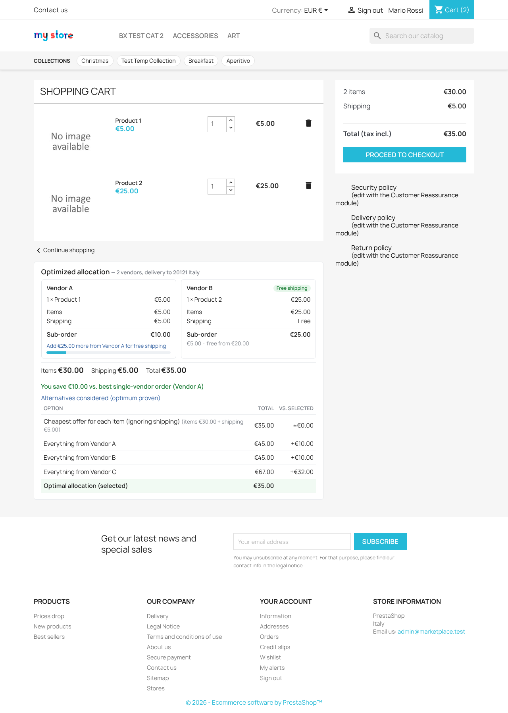
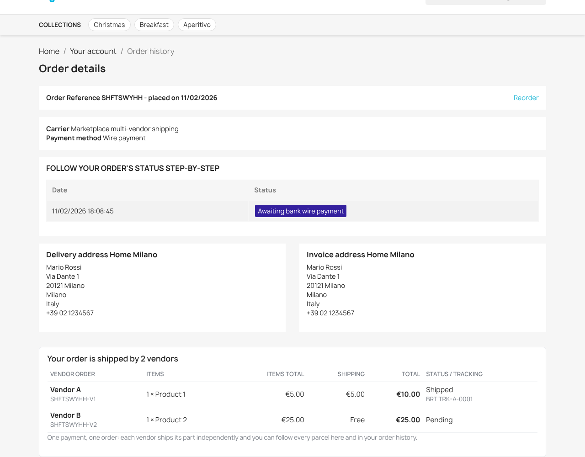
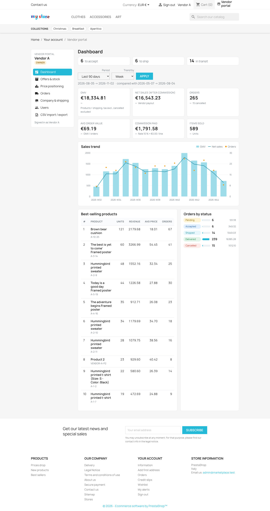

# POC Report — Multi-Vendor B2B/B2C Marketplace on PrestaShop 9

| | |
|---|---|
| **Responds to** | *Requirements & Scope Document — Multi-Vendor B2B/B2C Marketplace*, BrainX Technologies, v1.0 (2 Nov 2026) |
| **Platform tested** | PrestaShop **9.0.3** (latest stable 9.0.x, official image), PHP 8.4, MariaDB 10.11, classic theme |
| **Date** | 2 November 2026 |
| **Branch** | `claude/bold-ramanujan-o4q2m3` |
| **Status** | POC complete — all 10 modules demonstrated end-to-end on a clean install |

---

## 0. Executive summary — feasibility verdict

**PrestaShop 9 is a feasible platform for this marketplace, within the client's constraints.**

The POC implements all 10 required modules as **6 proprietary PrestaShop modules** (~25k lines of PHP, templates and JS, excluding vendor libraries). The constraints held throughout:

- clean 9.0.3 install;
- **zero core file changes and an empty `/override` directory**;
- no third-party multi-vendor modules;
- only public extension points: hooks, ObjectModel, `ModuleFrontController`/`ModuleAdminController`, the carrier-module API and cart-scoped `SpecificPrice`.

The make-or-break requirement is the **Smart Cart Optimizer (scope §5)**, and it works inside native PrestaShop checkout. The client's reference scenario resolves to **€35** (Vendor A → P1, Vendor B → P2). It goes through PrestaShop's own cart, carrier, payment and order pipeline and ends as one customer payment split into two vendor orders with per-vendor commissions. This was verified by an automated browser test on a from-scratch install (30/30 checks).

| Evidence | Result |
|---|---|
| Unit tests (PHPUnit, 6 suites) | **190 tests green**: core 43, CSV 59, checkout 24, vendor portal 34*, admin 8, collections 17 |
| Browser E2E (Playwright, headless Chromium) on a clean `docker compose down -v` reinstall | checkout **30/30**, vendor portal **73/73**, collections **11/11** |
| Back-office sweep | all 18 Marketplace tabs + their edit forms + native Orders/Products pages render with no errors |
| Reproducibility | `docker compose up -d && ./scripts/setup.sh` rebuilds the full demo from nothing |

\* *Vendor-portal suite count is from its author's run. My independent re-run of the other five suites matched their reported counts exactly.*

The main risks are not platform blockers but design decisions to agree with the client:

- VAT ownership per vendor (§8.2)
- live Mangopay KYC/wallet onboarding
- blended unit price on a split line under "round per item" tax mode
- infrastructure needed at 30 vendors / large catalogs (§7)

---

## 1. Project overview — what the POC demonstrates

The doc's core promise is: independent vendors list offers on one master catalog → one responsive storefront → unified cart → **single payment** → **optimizer allocates across vendors for the lowest total including shipping**.

That promise is demonstrated end-to-end:

1. A vendor imports offers by CSV.
2. Identical references are matched to the master catalog.
3. Offers are compared on the product page.
4. The optimizer allocates the cart.
5. The customer pays once.
6. Vendor sub-orders are created with commissions and a Mangopay-style payment split.
7. Vendors fulfil and track independently.
8. Admin reports and settles.



---

## 2. Business context and scale — how each requirement is met

| Requirement (scope §2) | POC implementation | Status |
|---|---|---|
| 1–30 vendors, 2–3 at launch | 3 demo vendors (A, B, C). Optimizer benchmarked to 30 vendors × 100 lines (heuristic, 1.5 s cap) | ✅ |
| 2,000–4,000 references, scalable | 4,100-row vendor CSV imported via async worker. Creation ~33 rows/s (~2 min for 4k new products); updates ~405 rows/s (10 s) | ✅ |
| B2B and B2C customers | Native PS customer groups, B2B mode and tax handling are untouched and usable. No B2B-specific pricing was built (see §8) | ⚠️ native only |
| Master catalog, multiple offers per SKU | Master = native `ps_product`/combination; offers = separate `bxmp_offer` table (`UNIQUE vendor+product+combination`) | ✅ |
| No minimum order value | Nothing enforced | ✅ |
| Vendor handles sales/invoicing/fulfilment/shipping | Vendor sub-orders with own status workflow, tracking and CSV export. Vendor-side invoicing is out of POC scope (§8) | ✅ / ⚠️ invoicing |
| Commission configurable per vendor | `commission_rate` % + `commission_fixed` per line, per vendor (demo: 10 %, 12.5 %, 8 % + €0.50) | ✅ |
| Single responsive storefront | Classic theme + module hooks only. Vendor portal checked at 390 px width | ✅ |
| One payment, vendor orders, automatic allocation (Mangopay) | One PS order → N `bxmp_vendor_order`. `MangopayPaymentSplitter` builds PayIn + per-vendor Transfers (Fees = commission) in **sandbox-simulation** mode (no credentials) | ✅ simulated |

---

## 3. Platform and build constraints — compliance

| Constraint | Evidence |
|---|---|
| Stable PS 9.x, clean install | `docker-compose.yml` → official `prestashop/prestashop:9.0` image (9.0.3), auto-installed on first boot |
| Use native catalog, customers, orders, checkout | Products/combinations, customers/addresses, cart, checkout, payment modules (`ps_wirepayment`) and orders are all native |
| All marketplace functionality in proprietary modules | `modules/bxmarketplace`, `bxmpcsv`, `bxmpcheckout`, `bxmpvendorportal`, `bxmpadmin`, `bxmpcollections` |
| No third-party multi-vendor modules | None installed |
| **No core modifications** | No PS core file touched; **`/override` is empty**. Integration is via 25 public hooks: `actionCartSave`, `actionPresentCart`, `actionValidateOrder`, `actionValidateStepComplete`, `actionFilterDeliveryOptionList`, `displayProductAdditionalInfo`, `displayShoppingCartFooter`, `displayAdminOrderMain`, `moduleRoutes`, … plus 6 custom `actionBxmp*` hooks |

*Environment note:* the sandbox could not reach `i18n.prestashop-project.org`. The installer always downloads a language pack from there, so `docker/pre-install-scripts/10-offline-langpack.sh` serves a minimal local pack. This is environment-only and is not needed on normal hosting.

---

## 4. Required custom modules — status per module

Legend: ✅ demonstrated and tested · ⚠️ partially / simulated · ❌ not in POC

### Module 1 — Vendor Management · `bxmarketplace` (admin) + `bxmpvendorportal` (vendor side)

| Requirement | Delivered | |
|---|---|---|
| Role-based vendor dashboards | FO vendor portal; vendors log in as PS customers linked via `bxmp_vendor_user`. Roles **owner / manager / staff**, enforced server-side per action, CSRF on every POST, strict vendor scoping (tampered IDs → 404, forged POSTs → 403, all tested) | ✅ |
| Vendors manage offers, pricing, inventory | Search/paginate, inline edit price, discount + window, stock, active; add offer by EAN; bulk stock update | ✅ |
| …orders, shipments | Workflow pending → accepted → shipped (tracking + carrier) → delivered / cancelled, with restock on cancel | ✅ |
| …commercial data | Company, VAT, payout account, contact; own shipping rules with simulator; user management (owner) | ✅ |
| Admin side | BO *Marketplace → Vendors / Vendor users / Shipping rules / Offers* CRUD | ✅ |

Screens: `screenshots/vendor-offers.png`, `vendor-orders.png`, `vendor-order-detail.png`, `vendor-shipping-rules.png`, `vendor-users.png`

### Module 2 — Standardized CSV Import/Export & Synchronization · `bxmpcsv`

| Requirement | Delivered | |
|---|---|---|
| Unified CSV schema (SKU, EAN, brand, title, description, price, discount, images, inventory…) | Documented in [`CSV_SCHEMA.md`](CSV_SCHEMA.md), with a downloadable template. Also covers variants (`Color:Red\|Size:M`, `parent_reference`) and validates each row strictly: delimiter auto-detect, BOM/Windows-1252 handling, decimal separators, Excel-mangled EANs, dates, duplicates | ✅ |
| Automated / asynchronous imports | Job queue (`bxmp_import_job`) with a single-worker lock and 500-row chunks. Resumable: verified by killing the container mid-job, after which it resumed from its checkpoint with no duplicates | ✅ |
| Scheduled synchronization | `bxmp_feed` per vendor (URL or whitelisted path, interval). Run by cron front controller (token) or CLI worker. Optional *full-sync* zeroes offers missing from the feed | ✅ |
| Order exports and status updates | Vendor order CSV export (BO, CLI, vendor portal, API). Status-update CSV import validates transitions and ownership and fires `actionBxmpVendorOrderStatusUpdate` | ✅ |

### Module 3 — Master Product Catalog & Matching Engine · `bxmarketplace` (engine) + `bxmpcsv` (exceptions)

| Requirement | Delivered | |
|---|---|---|
| Centralized catalog | Native PS products/combinations are the master catalog | ✅ |
| Automated matching of identical references | `MatchingEngine` matches in order: EAN exact → reference/MPN + brand → normalized title similarity. Unmatched rows can auto-create the master product (configurable) | ✅ |
| Multiple offers per product | Separate offer model, one per vendor × product × combination | ✅ |
| Exception handling for ambiguous matches | `bxmp_match_exception` queue with BO actions *link to product / link to combination / create new / retry / reject*. Resolutions are replayed on the next import; rejected SKUs are skipped | ✅ |

### Module 4 — Dynamic Price Comparison Engine · `bxmarketplace` + `bxmpcheckout`

| Requirement | Delivered | |
|---|---|---|
| Automated comparison for identical SKUs | `PriceComparator` ranks offers on exact product + combination | ✅ |
| Considers discounts, availability, delivery eligibility | Effective price respects the discount window; out-of-stock offers excluded; offers ineligible for the customer's country/postcode excluded; ranking by *delivered* price (incl. shipping) | ✅ |
| Storefront | Product-page offer table with "Best total" badge (`screenshots/checkout-product-offers.png`) | ✅ |

### Module 5 — Smart Cart Optimization Engine · `bxmarketplace` (`CartOptimizer`) + `bxmpcheckout`

| Requirement | Delivered | |
|---|---|---|
| Lowest total checkout cost incl. shipping across vendors | Exact branch-and-bound for baskets of ≤12 distinct lines; it is cross-checked against brute force on 120 random baskets. Larger baskets use a greedy + local-search heuristic: optimal in ≥90 % of tests, never more than 5 % off | ✅ |
| Allocation, shipping costs, free/reduced thresholds, consolidation | Per-vendor rules: base, reduced (≥ threshold) and free (≥ threshold) shipping. Consolidating items at one vendor emerges from cost minimisation | ✅ |
| Never substitutes | Matching only on `id_product` + `id_product_attribute`. When stock is short, checkout is **blocked with a message**, never substituted (E2E-tested) | ✅ |

See §5 below for the client scenario.

### Module 6 — Multi-Vendor Shipping & Checkout · `bxmpcheckout`

| Requirement | Delivered | |
|---|---|---|
| Unified cart and checkout | Native PS cart/checkout. Optimized per-vendor sub-baskets shown in the cart and at the shipping step | ✅ |
| Vendor-specific shipping + configurable thresholds | Carrier module returns the sum of per-vendor shipping for the delivery country/postcode. Rules are editable by admin and vendor | ✅ |
| Automatic order splitting | `actionValidateOrder` → one `bxmp_vendor_order` per vendor (`PARENTREF-V{id}`) with lines, shipping, commission and payout. Vendor stock decremented. Idempotent | ✅ |
| Independent fulfilment tracking per vendor | Per-vendor status/carrier/tracking from the vendor portal, BO order page panel and status CSV. Customer order detail shows tracking per vendor | ✅ |



### Module 7 — Vendor-Specific Commission Management · `bxmarketplace` (`CommissionCalculator`) + `bxmpadmin`

| Requirement | Delivered | |
|---|---|---|
| Commission rate per vendor | % + fixed-per-line, per vendor | ✅ |
| Automated calculations and adjustments | Computed at order split. Manual adjustments must give a reason. If a rate changes, the review page recalculates unsettled orders only; approved/paid settlements stay locked | ✅ |
| Settlement reports and reconciliation | Settlements per vendor and period go draft → approved → paid, with overlapping periods refused, plus a statement CSV. The reconciliation view flags mismatches: missing transfer refs, cancelled-but-paid orders, terms drift, vendor orders ≠ parent order, and stored vs live settlement totals | ✅ |

### Module 8 — Vendor Dashboard & Business Analytics · `bxmpvendorportal`

| Requirement | Delivered | |
|---|---|---|
| Private vendor dashboards | Vendor-scoped; staff role sees no financial KPIs | ✅ |
| Sales, GMV, orders, best sellers, commissions, historical trends | KPI tiles with change vs the previous period, day/week/month trend chart, best sellers, orders by status | ✅ |
| Competitive price positioning for identical SKUs | Per-offer rank, best competitor price, Δ %, buy-box flag; positioning page with a suggested price to become cheapest and one-click apply | ✅ |



### Module 9 — Central Administration & Advanced Analytics · `bxmpadmin`

| Requirement | Delivered | |
|---|---|---|
| Aggregate and vendor-level reporting | Dashboard with period and vendor filters; vendor league table (GMV, share, commission, payout, avg shipping, fulfilment rate, hours-to-ship, cancellation rate, buy-box share) | ✅ |
| GMV, revenue, commissions, orders, customers, products, conversions, performance | All present as KPI tiles with change vs the previous period. Conversion = orders ÷ visits (native `ps_connections`); cart abandonment; offers per product | ✅ |
| Exportable reports | 11 CSV exports, one for each report | ✅ |
| Full control over vendor accounts, commission rates, commercial conditions | *Commercial conditions* overview with quick activate/deactivate and links to vendor edit; vendor CRUD in core | ✅ |

Screens: `screenshots/admin-dashboard.png`, `admin-settlements.png`, `admin-reconciliation.png`

### Module 10 — Dynamic Categories & Thematic Collections · `bxmpcollections`

| Requirement | Delivered | |
|---|---|---|
| Custom category management | BO page to create/rename/move/(de)activate native categories, plus a vendor-label → category mapping that the importer can use | ✅ |
| Cross-category thematic collections | Collections hold hand-picked products + whole categories. Demo set: Christmas, Easter, Halloween, Carnival, All Saints' Day, Breakfast, Aperitivo. Friendly URL `/collection/{slug}`, homepage block, menu strip | ✅ |
| Scheduled activation / deactivation | Live = active **and** now within the start/end window, evaluated at render time, so it works without cron. A cron job logs transitions, fires a hook and clears caches. Scheduled/expired collections return 404 | ✅ |

---

## 5. Smart Cart Optimization — client reference scenario

**Input:** P1 ×1 and P2 ×1, delivered to Milan 20121 (IT). Vendor C also offers both products, at worse prices, as a distractor.

| Allocation (as listed by the optimizer in the cart) | Total |
|---|---|
| Everything from Vendor A | €45.00 |
| Everything from Vendor B | €45.00 |
| Everything from Vendor C | €67.00 |
| **P1 from A (€5 + €5 shipping) + P2 from B (€25, free shipping) — selected, optimum proven** | **€35.00** |

**Native PrestaShop result** (E2E, fresh install):

- **Parent order:** products €30, shipping €5, paid **€35**.
- **Vendor A sub-order:** €5 + €5 shipping = €10. Commission 10 % = €0.50; payout €9.50.
- **Vendor B sub-order:** €25, free shipping. Commission 12.5 % = €3.13; payout €21.87.
- **Payment:** Mangopay-format PayIn + 2 Transfers recorded (sandbox simulation).

**"The engine must also handle" (scope §5):**

| Requirement | Verified by |
|---|---|
| Larger baskets | Unit tests: 12 lines × 8 vendors exact in 0.13 s; 30 × 5 heuristic in 0.1 s; 100 × 30 heuristic within the 1.5 s cap |
| Quantity splitting across vendors | E2E: t-shirt qty 5 → 3 from B + 2 from A, €120.23; native cart total equals the optimizer total exactly |
| Available stock per vendor | E2E: stock dropped below the cart quantity → checkout blocked with a message; restored → unblocked |
| Vendor-specific shipping rules and thresholds | Unit tests for free and reduced thresholds; scenario above |
| Destination / postcode restrictions | Vendor C excludes Sardinian postcodes (`09*`); API test with 09124 excludes Vendor C |
| Exact product/variant matching, no substitution | Matching on product + combination only; unavailable → HTTP 422 from the API / blocked checkout |
| One payment, vendor orders, automatic allocation, configurable commission | Scenario above |

---

## 6. Technical requirements — compliance

| Area | How it is met |
|---|---|
| PS 9.x, no core modifications | 9.0.3, no core edits, empty `/override` |
| Modular and scalable (3 → 30 vendors) | 6 modules on one core contract (`docs/ARCHITECTURE.md`). Vendor count is data, not code. Optimizer and importer were benchmarked at 30 vendors / 4k rows |
| Separate data models: master products vs vendor offers | `ps_product` vs `ps_bxmp_offer` (+ shipping rules, vendor orders, settlements…: 18 core tables) |
| Asynchronous CSV processing, scheduled sync | Job queue + chunked worker + cron/feeds (Module 2) |
| Documented internal APIs | JSON API with Bearer tokens (vendor-scoped tokens cannot touch other vendors' data, 401/403 verified). Documented in [`API.md`](API.md) and [`openapi.yaml`](openapi.yaml): vendors, offers, product offers/comparison, `cart/optimize`, vendor orders, order export |
| Responsive storefront | Classic theme; marketplace blocks responsive; vendor portal tested at 390 px |
| Security | Role checks on every vendor action, CSRF tokens, token-protected cron, admin tokens, input validation and HTML-injection rejection in CSV, whitelisted import paths |
| Logging | `bxmp_log` with channels (`payment`, `import`, `optimizer`, …) |
| Automated testing | 190 PHPUnit tests + 3 Playwright suites (114 checks) |
| Technical documentation | `docs/ARCHITECTURE.md`, `API.md`, `openapi.yaml`, `CSV_SCHEMA.md`, one README per module |

---

## 7. What the client expects in the response

### 7.1 Scope coverage and split (MVP vs scale-to-30)

The POC shows that all 10 modules fit PrestaShop 9. For the proposal we recommend this split:

**MVP — launch with 2–3 vendors.** All 10 modules, hardened from the POC. Additions:

- live Mangopay: KYC, wallets, PayIn webhooks before Transfers, refunds;
- vendor invoicing / credit notes;
- B2B price lists if required;
- transactional emails to vendors;
- multilingual content (IT/EN);
- production theme/UX;
- GDPR flows;
- a CI pipeline.

**Scale to 30 vendors.** Infrastructure and development that can be scoped separately:

- a message queue (Symfony Messenger + RabbitMQ/Redis) replacing the DB-backed job queue;
- a Redis cache;
- an Elasticsearch/OpenSearch catalog search;
- DB read replica for analytics;
- pre-aggregated analytics tables;
- per-vendor connectors (SFTP/API pull);
- load testing (k6) and an auto-scaling hosting setup;
- an observability stack;
- a vendor self-onboarding flow.

### 7.2 Itemized effort estimate (production build, for discussion)

These are indicative estimates for the production build, informed by the POC. The POC code is reused as the starting point. Ranges cover remaining uncertainty: Mangopay live integration, the B2B pricing depth and the UX design scope.

| # | Module | MVP hours | Scale-to-30 hours |
|---|---|---|---|
| 1 | Vendor Management (admin + portal, roles, onboarding) | 100–130 | 40 (self-onboarding, KYC flow) |
| 2 | CSV Import/Export & Sync | 100–130 | 60 (queue broker, SFTP/API connectors) |
| 3 | Master Catalog & Matching | 80–110 | 30 (fuzzy-match tuning at volume) |
| 4 | Price Comparison | 40–60 | 20 (search-index integration) |
| 5 | Smart Cart Optimizer | 90–120 | 30 (perf tuning, caching) |
| 6 | Multi-Vendor Shipping & Checkout (incl. live Mangopay) | 160–220 | 30 |
| 7 | Commission Management & Settlements | 70–90 | 10 |
| 8 | Vendor Dashboard & Analytics | 70–90 | 30 (pre-aggregation) |
| 9 | Central Admin & Analytics | 80–100 | 40 (pre-aggregation, read replica) |
| 10 | Categories & Thematic Collections | 30–50 | 10 |
| — | Theme/UX (responsive storefront, simplified UX) | 80–120 | — |
| — | Architecture, DevOps, CI/CD, environments | 50–70 | 80 (Redis, ES, queue, autoscaling, observability) |
| — | QA & test automation, UAT support | 120–160 | 40 (load testing) |
| — | Security review, docs, handover | 50–70 | 20 |
| — | Project management (~12 %) | 135–185 | 55 |
| | **Total** | **≈ 1,255–1,705 h** | **≈ 495 h** |

### 7.3 Milestones and timeline (indicative, team of 3 devs + QA + PM)

| Milestone | Weeks | Deliverables |
|---|---|---|
| M0 Foundation | 1–2 | Environments, CI, core schema/contract, theme baseline |
| M1 Catalog & vendors | 3–6 | Modules 1, 2, 3; vendor onboarding; first vendor feeds imported |
| M2 Commerce engine | 6–10 | Modules 4, 5, 6 with live Mangopay sandbox; end-to-end checkout |
| M3 Money & insight | 10–13 | Modules 7, 8, 9; settlements and reconciliation |
| M4 Merchandising & UX | 12–14 | Module 10, storefront polish, emails, translations |
| M5 Hardening & launch | 14–17 | UAT, security, performance, go-live with 2–3 vendors |
| Scale phase | after launch, 5–7 weeks | Queue/cache/search infrastructure, connectors, load tests to 30 vendors |

### 7.4 Platform-specific challenges and how they were addressed (no core changes)

| Challenge | Approach proven in the POC | Residual risk / decision |
|---|---|---|
| PS prices a cart line at **one price**, but the optimizer may split quantity across vendors at different prices | Cart-scoped native `SpecificPrice` (`id_cart`) holding the **blended unit price** per product/combination; PS deletes these at order creation. Native totals equal the optimizer totals | With the *round per item* tax setting, a split line can drift by ~€0.01–0.02; *round per line* (demo setting) is exact. Recommend *round per line*. Purge cart-scoped prices of abandoned carts with a cron job |
| Per-vendor shipping with thresholds is not native | Carrier module (`getOrderShippingCost`) returns the sum of per-vendor shipping; other carriers hidden for marketplace carts | Carrier-restricted products would need extra rules |
| One payment but N vendor orders | One PS parent order (native payment/invoice/refunds) + `bxmp_vendor_order` sub-orders + payment splitter. PS's native "split order by carrier" was evaluated and rejected: it cannot express vendor thresholds | Decide whether the parent invoice is issued by the platform or replaced by per-vendor invoices |
| **VAT per vendor** | Engine and vendor orders are tax-excluded; PS taxes the parent order; VAT stays in escrow as a residual | **Needs a client/accountant decision** (vendors as sellers of record vs platform) — affects invoicing scope |
| Mangopay | Adapter interface + payload builder (PayIn to escrow, Transfers with Fees = commission, idempotency keys), simulated transport | Live keys, KYC, webhook-driven Transfers (after PayIn success), refunds/chargebacks: in MVP estimate |
| Vendor login inside PS | Vendors are PS customers linked to vendor accounts; portal as `ModuleFrontController`s | Alternative (vendors as BO employees with restricted profiles) is possible but riskier for data isolation; FO portal recommended |
| Module class-name collisions (PHP class names are case-insensitive) | Module `bxmpvendor` would clash with core class `BxmpVendor` → renamed `bxmpvendorportal` | Naming convention captured in architecture doc |
| Live-mounted `vendor/` during dev | Running composer in a mounted module dir briefly breaks the shop | Build artifacts in CI, deploy immutable releases |
| Language pack download at install | Offline workaround script for restricted networks | None on normal hosting |

---

## 8. POC shortcuts and known limitations (not production-ready yet)

1. **Payments are simulated:** no Mangopay credentials, KYC or webhooks; Transfers fire at order validation.
2. **Vendor invoicing / credit notes** are not built; PS issues the parent invoice only.
3. **B2B-specific features** are limited to native PS: no per-customer-group vendor price lists, quotes or payment terms.
4. **Taxes:** the engine is tax-excluded, and VAT allocation per vendor is not designed yet (see §7.4).
5. **Products without any vendor offer** cannot be sold (no first-party selling).
6. **Analytics:**
   - Demo history consists of synthetic `HIST-` vendor orders. Conversion % is therefore unrealistic, because the visit data doesn't match.
   - "Time to ship" uses the last-update date.
   - Buy-box share is a current snapshot.
7. **Imports:**
   - Allows one offer per vendor × product × combination.
   - Images are imported only on product creation.
   - The per-chunk transaction is best-effort; resume relies on idempotent processing.
8. **Single shop only:** no PS multistore. Emails to vendors are not implemented, and the UI is English only.
9. **Demo EANs:** `8000000000011` / `8000000000028` from the brief fail the EAN check digit. They are accepted with a warning; strict mode is available.

---

## 9. How to run the demo

```bash
docker compose up -d && ./scripts/setup.sh
```

**URLs and accounts**

| What | Where / login |
|---|---|
| Storefront | http://localhost:8080 |
| Back office (*Sell → Marketplace*) | http://localhost:8080/admin-dev, `admin@marketplace.test` / `Admin123!` |
| Customer | `customer@marketplace.test` / `Customer123!` |
| Vendor owners | `vendor-a@`, `vendor-b@`, `vendor-c@marketplace.test` / `Vendor123!` |
| Vendor A staff / manager | `staff-a@`, `manager-a@marketplace.test` / `Vendor123!` |

**Reproduce the scenario:** log in as the customer → add *Product 1* and *Product 2* → cart shows €35 with the A/B split → checkout with bank wire.

**Tests**

```bash
node modules/bxmpcheckout/tests/e2e/checkout.e2e.js
node modules/bxmpvendorportal/tests/e2e/portal.e2e.js
node modules/bxmpcollections/tests/e2e/collections.e2e.js
```

Unit tests: `composer install && composer test` in each module. Run them on a copy, not in the live-mounted folder.

## 10. Repository map

| Path | Content |
|---|---|
| `docker-compose.yml`, `docker/`, `scripts/setup.sh` | Environment and one-command setup |
| `modules/bxmarketplace` | Core: schema (18 tables), ObjectModels, engines (optimizer, matching, pricing, commission, shipping rules), JSON API, vendor admin, demo seeder |
| `modules/bxmpcsv` | Module 2 + matching exceptions |
| `modules/bxmpcheckout` | Modules 4 (storefront), 5 (integration), 6 |
| `modules/bxmpvendorportal` | Modules 1 (vendor side), 8 |
| `modules/bxmpadmin` | Modules 7, 9 |
| `modules/bxmpcollections` | Module 10 |
| `docs/` | Architecture, API (+OpenAPI), CSV schema, this report, screenshots |
